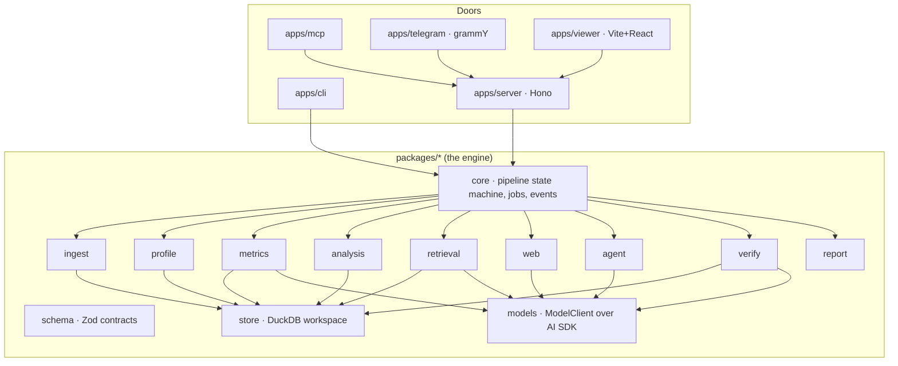
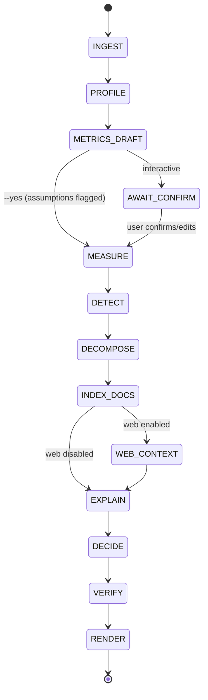

# agentic-analytics

**Open-source, self-hosted agentic analytics. Any data in, verified decisions out.**

<picture>
  <source media="(prefers-color-scheme: dark)" srcset="docs/assets/readme/hero-dark.svg">
  
</picture>

Give it a business's real files: spreadsheets, CSV exports, PDFs, Word documents and emails. It returns a report on what changed, why it changed, where the data is wrong, and what to do next.

- **Every number** is computed by SQL in DuckDB and recomputed by a verifier before the report ships. The model never does arithmetic.
- **Every claim** links to the exact row, cell, page or URL it came from.

It runs **fully locally, at $0**: models through Ollama (or a free endpoint such as Groq), and web search through self-hosted SearXNG. There's no telemetry.

> **Status: v0.1, early.** The engine, the verifier and all four doors work end to end. The eval bars are not all met yet, and the results below are shown as they are. See [evals/RESULTS.md](evals/RESULTS.md) and [docs/ROADMAP.md](docs/ROADMAP.md).


<sub>Scripted, deterministic run (`AA_DEMO_MODEL=scripted`, no LLM), recorded from `examples/coffee-roaster` by `scripts/readme-assets/demo.sh`.</sub>

## Quickstart

```bash
git clone https://github.com/gfirik/agentic-analytics && cd agentic-analytics
bun install
bun run aa doctor                 # what this machine has: Node, DuckDB, models, SearXNG

# A model: local Ollama…
ollama pull qwen3.5:9b
# …or a free hosted endpoint (put the key in .env, never in a command you share)
cp .env.example .env              # then set GROQ_API_KEY and PLANNER_MODEL=openai-compatible:groq:qwen/qwen3.8-27b

bun run aa analyze examples/coffee-roaster --yes --currency USD --today 2026-07-01 --small-model --embedder hash --open
```

- `--embedder hash` skips the 1 GB embedding-model download for a first run. Drop it for better document search.
- `--yes` keeps the drafted metric definitions as assumptions. Without it you review them first.
- Docker: `docker compose up` starts the API, the viewer and MCP on `http://127.0.0.1:8080`.
- No Node or Bun: each release attaches a standalone `aa` binary (Linux x64/arm64, macOS arm64, Windows x64) with `SHA256SUMS`. It runs every command except the viewer at `/`, and indexes documents with the offline hash embedder (lexical); use Docker or the Node CLI for semantic document search.

Full guide: [the docs site](https://gfirik.github.io/agentic-analytics/start/quickstart/).

## What it fixes

<!-- table:problems:start -->
| Problem | Typical AI analyst | agentic-analytics |
|---|---|---|
| **Confidently wrong numbers** | The model does arithmetic in its head; reviews of AI data tools cite figures that were simply wrong. | The model never computes. DuckDB runs the SQL, and a verifier recomputes every number before the report ships. [How →](https://gfirik.github.io/agentic-analytics/how-it-works/verifier/) |
| **Spreadsheets treated as text** | Excel files are chunked like documents, so totals and trends are invented. | Tables are detected and loaded as real tables (merged headers, several tables per sheet). Text gets search, numbers get SQL. [How →](https://gfirik.github.io/agentic-analytics/how-it-works/ingest/) |
| **No way to check a claim** | Answers arrive as prose with no source. | Every claim carries a row, cell, page or URL, clickable in the HTML report. [How →](https://gfirik.github.io/agentic-analytics/reference/report-schema/) |
| **Advice with no basis** | “Consider improving marketing.” | Recommendations cite verified findings, carry an impact range and confidence, and name the metric and date that will judge them. [How →](https://gfirik.github.io/agentic-analytics/how-it-works/decide/) |
| **Tables, documents and the web never meet** | Text-to-SQL tools ignore documents; research agents ignore your numbers. | One analysis joins three lanes; outside sources are always labelled External and can never replace your numbers. [How →](https://gfirik.github.io/agentic-analytics/how-it-works/documents/) |
| **Business data leaves the building** | Hosted tools upload your files to a vendor. | Self-hosted, works fully offline with Ollama, no telemetry; web queries are sanitized of names and numbers. [How →](https://gfirik.github.io/agentic-analytics/how-it-works/web/) |
| **Hard to plug into a real system** | Chat UIs only. | A typed JSON report schema, an HTTP API, an MCP server, a CLI and a Telegram demo over one engine. [How →](https://gfirik.github.io/agentic-analytics/use-it/http-api/) |
| **Correct math on the wrong thing** | The model measures a nearby metric, the wrong period, or gross where you meant net. | Metric definitions are drafted, shown in plain words and confirmed; the verifier checks every number against its definition. [How →](https://gfirik.github.io/agentic-analytics/how-it-works/metrics/) |
| **Instructions hidden in your files** | A line in a PDF or a spreadsheet cell can steer the model or leak data. | Untrusted text is screened and read only by a quarantined extractor with no tools; a 23-fixture injection suite runs in CI. [How →](https://gfirik.github.io/agentic-analytics/how-it-works/security/) |
<!-- table:problems:end -->

## How it works

<!-- diagram:architecture:start -->

<!-- diagram:architecture:end -->

1. **Ingest and profile.** Tables are detected inside messy spreadsheets: merged headers, several tables on one sheet. Documents are parsed into sections. Data-quality problems become findings of their own.
2. **Metric layer.** Definitions are drafted (what "revenue" means, the grain, the currency, the filters), shown in plain words, and confirmed or kept as flagged assumptions.
3. **Analyze.** SQL insight templates find the changes. Decompositions (contribution, price–volume–mix, rate vs mix) split each change into drivers.
4. **Explain.** Drivers are matched to events quoted from your documents and to labelled outside benchmarks. Each "why" is graded: observed, correlated or document-supported.
5. **Decide.** Recommendations cite verified findings and carry an impact range computed in code, a confidence level and a dated check.
6. **Verify.** Every number is recomputed, headline metrics are re-derived another way, and every citation is checked. Anything that fails is dropped or downgraded before the report ships.

<details><summary>The pipeline, stage by stage</summary>

<!-- diagram:pipeline:start -->

<!-- diagram:pipeline:end -->

</details>

## Use it four ways

| Door | Example |
|---|---|
| CLI | `aa analyze ./q2-exports --open` · `aa ask <job> "why did refunds rise?"` · `aa explain <job> N12` |
| HTTP API | `aa serve` → `POST /v1/jobs` with files, SSE progress, `GET /v1/jobs/{id}/report` (OpenAPI at `/openapi.json`) |
| MCP server | `aa mcp`: Claude Desktop, Cursor or any agent calls `analyze_files` and gets the verified report back |
| Telegram demo | Send files to your bot and get the summary and `report.html` back |

## Eval results

Thirty generated businesses with planted events, distractors and data-quality issues. The table shows real models only; the scripted baseline that checks the harness is in [evals/RESULTS.md](evals/RESULTS.md).

<!-- table:evals:start -->
| Model | Suite | Jobs completed | Planted recall@5 | Driver accuracy | Number mismatches | Citation precision | Cost / time | Hardware |
|---|---|---|---|---|---|---|---|---|
| groq:openai/gpt-oss-120b (small-model mode) | smoke (3) | 33% | 0% | n/a | 0 | n/a | 3 min, 31k tokens | Groq free tier (hosted) |
| groq:openai/gpt-oss-20b (small-model mode) | smoke (3) | 33% | 0% | 0% | 0 | 100% | 12 min, 91k tokens | Groq free tier (hosted) |
| groq:qwen/qwen3.8-27b (small-model mode) | smoke (3) | 100% | 0% | 0% | 0 | 100% | 20 min, 101k tokens | Groq free tier (hosted) |
<!-- table:evals:end -->

## Stack

TypeScript on Node 22, Hono, and DuckDB for all SQL and all search (full-text and vector), in one file per job. The model layer is the Vercel AI SDK with Ollama and OpenAI-compatible free endpoints. Embeddings and reranking run in-process. Docling is optional for hard PDFs. Bun is the package manager. The reasoning behind each choice is in [docs/DECISIONS.md](docs/DECISIONS.md).

```bash
bun install && bun run check   # lint, types, 500+ tests, schema drift, README drift: no model or key needed
```

## Documentation

| Doc | What it covers |
|---|---|
| [Docs site](https://gfirik.github.io/agentic-analytics/) | Quickstart, how each stage works (with visual explainers), the doors, reference |
| [docs/ARCHITECTURE.md](docs/ARCHITECTURE.md) | Packages, data flow, diagrams |
| [docs/specs/](docs/specs) | Detailed specs for every subsystem |
| [docs/EVALS.md](docs/EVALS.md) · [evals/RESULTS.md](evals/RESULTS.md) | How quality is measured, and the latest results |
| [docs/ROADMAP.md](docs/ROADMAP.md) | Milestones and what's next |
| [CONTRIBUTING.md](CONTRIBUTING.md) · [SECURITY.md](SECURITY.md) | How to contribute; how to report a vulnerability |
| [AGENTS.md](AGENTS.md) | Rules for AI coding agents working in this repo |

## License

Apache-2.0. Built by [fhsystems](https://fhsystems.dev).
