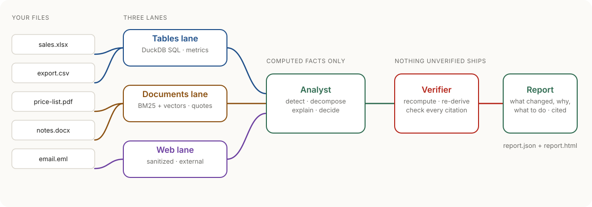
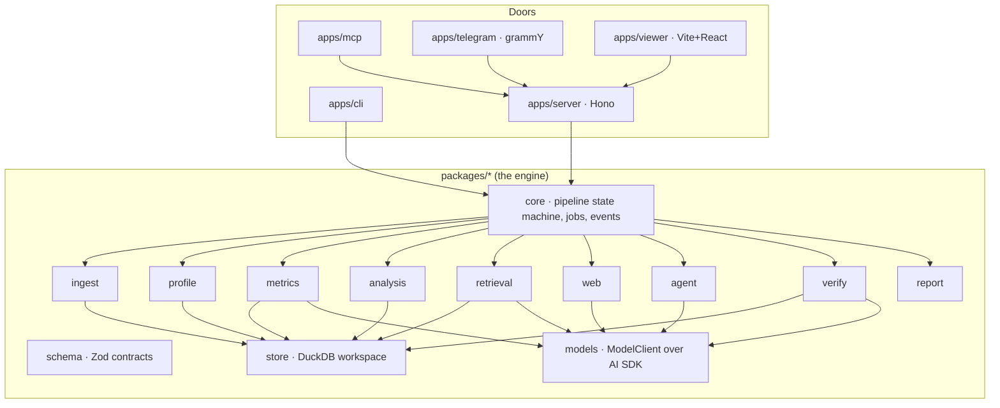
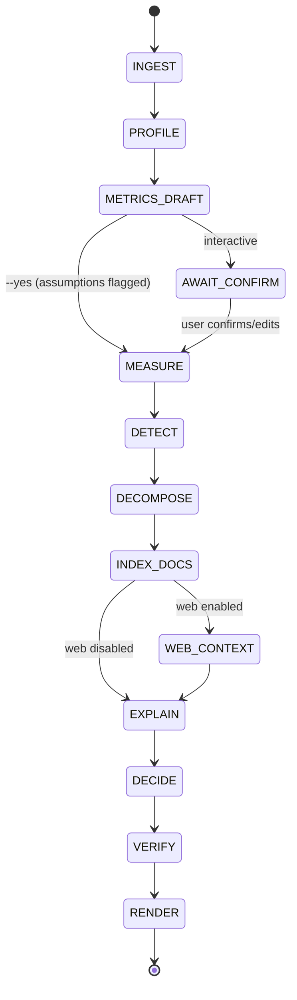

# agentic-analytics

**Open-source, self-hosted agentic analytics. Any data in, verified decisions out.**

<picture>
  <source media="(prefers-color-scheme: dark)" srcset="docs/assets/readme/hero-dark.svg">
  
</picture>

Give it a business's real files: spreadsheets, CSV exports, PDFs, Word documents and emails. It returns a report on what changed, why it changed, where the data is wrong, and what to do next.

- **Every number** is computed by SQL in DuckDB and recomputed by a verifier before the report ships. The model never does arithmetic.
- **Every claim** links to the exact row, cell, page or URL it came from.

It runs **fully locally, at $0**: models through Ollama (or a free endpoint such as Groq), and web search through self-hosted SearXNG. There's no telemetry.

<!-- status:start -->
> **Status: v0.1, early.** What is proven so far:
>
> - **Real public data:** 12 of 12 checks pass on 2 public datasets, each expected answer set by SQL written separately ([details](#real-public-data)).
> - **A free real model:** qwen/qwen3.8-27b planner, gpt-oss-120b extractor, gpt-oss-20b judge (Groq free tier) finished 3 of 3 smoke jobs with 0 wrong numbers and 100% citation precision ([details](#real-model-runs)).
> - **Every report is verified:** before a report ships, the verifier recomputes every number and checks every citation. 500+ tests run with no model or key.
>
> 30 generated businesses with planted events are the nightly regression check (each run over up to two nights within the free tier's daily quota: a night the quota cuts short resumes the next); the latest published run is in [Real-model runs](#real-model-runs), shown as it is. Plans: [docs/ROADMAP.md](docs/ROADMAP.md).
<!-- status:end -->


<sub>Scripted, deterministic run (`AA_DEMO_MODEL=scripted`, no LLM), recorded from `examples/coffee-roaster` by `scripts/readme-assets/demo.sh`.</sub>

## Quickstart

```bash
git clone https://github.com/gfirik/agentic-analytics && cd agentic-analytics
bun install
bun run aa doctor                 # what this machine has: Node, DuckDB, models, SearXNG

# A model: local Ollama…
ollama pull qwen3.5:9b
# …or a free hosted endpoint (put the key in .env, never in a command you share)
cp .env.example .env              # then set GROQ_API_KEY and PLANNER_MODEL=openai-compatible:groq:qwen/qwen3.8-27b

bun run aa analyze examples/coffee-roaster --yes --currency USD --today 2026-07-01 --small-model --embedder hash --open
```

- `--embedder hash` skips the 1 GB embedding-model download for a first run. Drop it for better document search.
- `--yes` keeps the drafted metric definitions as assumptions. Without it you review them first.
- Docker: `docker compose up` starts the API, the viewer and MCP on `http://127.0.0.1:8080`.
- No Node or Bun: each release attaches a standalone `aa` binary (Linux x64/arm64, macOS arm64, Windows x64) with `SHA256SUMS`. It runs every command except the viewer at `/`, and indexes documents with the offline hash embedder (lexical); use Docker or the Node CLI for semantic document search.

Full guide: [the docs site](https://gfirik.github.io/agentic-analytics/start/quickstart/).

## What it fixes

<!-- table:problems:start -->
| Problem | Typical AI analyst | agentic-analytics |
|---|---|---|
| **Confidently wrong numbers** | The model does arithmetic in its head; reviews of AI data tools cite figures that were simply wrong. | The model never computes. DuckDB runs the SQL, and a verifier recomputes every number before the report ships. [How →](https://gfirik.github.io/agentic-analytics/how-it-works/verifier/) |
| **Spreadsheets treated as text** | Excel files are chunked like documents, so totals and trends are invented. | Tables are detected and loaded as real tables (merged headers, several tables per sheet). Text gets search, numbers get SQL. [How →](https://gfirik.github.io/agentic-analytics/how-it-works/ingest/) |
| **No way to check a claim** | Answers arrive as prose with no source. | Every claim carries a row, cell, page or URL, clickable in the HTML report. [How →](https://gfirik.github.io/agentic-analytics/reference/report-schema/) |
| **Advice with no basis** | “Consider improving marketing.” | Recommendations cite verified findings, carry an impact range and confidence, and name the metric and date that will judge them. [How →](https://gfirik.github.io/agentic-analytics/how-it-works/decide/) |
| **Tables, documents and the web never meet** | Text-to-SQL tools ignore documents; research agents ignore your numbers. | One analysis joins three lanes; outside sources are always labelled External and can never replace your numbers. [How →](https://gfirik.github.io/agentic-analytics/how-it-works/documents/) |
| **Business data leaves the building** | Hosted tools upload your files to a vendor. | Self-hosted, works fully offline with Ollama, no telemetry; web queries are sanitized of names and numbers. [How →](https://gfirik.github.io/agentic-analytics/how-it-works/web/) |
| **Hard to plug into a real system** | Chat UIs only. | A typed JSON report schema, an HTTP API, an MCP server, a CLI and a Telegram demo over one engine. [How →](https://gfirik.github.io/agentic-analytics/use-it/http-api/) |
| **Correct math on the wrong thing** | The model measures a nearby metric, the wrong period, or gross where you meant net. | Metric definitions are drafted, shown in plain words and confirmed; the verifier checks every number against its definition. [How →](https://gfirik.github.io/agentic-analytics/how-it-works/metrics/) |
| **Instructions hidden in your files** | A line in a PDF or a spreadsheet cell can steer the model or leak data. | Untrusted text is screened and read only by a quarantined extractor with no tools; a 23-fixture injection suite runs in CI. [How →](https://gfirik.github.io/agentic-analytics/how-it-works/security/) |
<!-- table:problems:end -->

## How it works

<!-- diagram:pipeline-gif:start -->
<picture>
  <source media="(prefers-reduced-motion: reduce) and (prefers-color-scheme: dark)" srcset="docs/assets/readme/pipeline-dark.png">
  <source media="(prefers-reduced-motion: reduce)" srcset="docs/assets/readme/pipeline-light.png">
  <source media="(prefers-color-scheme: dark)" srcset="docs/assets/readme/pipeline-dark.gif">
  <source media="(prefers-color-scheme: light)" srcset="docs/assets/readme/pipeline-light.gif">
  
</picture>

<sub>One real engine run on `examples/coffee-roaster` with the scripted planner (no LLM) and an offline web fixture: every number on screen comes from that run: facts are shown with their ids, counts come from the report and the verifier's check table, and the stages follow its event log. Recorded by `scripts/readme-assets/pipeline-gif.ts` from the same animation as the docs site.</sub>
<!-- diagram:pipeline-gif:end -->

1. **Ingest and profile.** Tables are detected inside messy spreadsheets: merged headers, several tables on one sheet. Documents are parsed into sections. Data-quality problems become findings of their own.
2. **Metric layer.** Definitions are drafted (what "revenue" means, the grain, the currency, the filters), shown in plain words, and confirmed or kept as flagged assumptions.
3. **Analyze.** SQL insight templates find the changes. Decompositions (contribution, price–volume–mix, rate vs mix) split each change into drivers.
4. **Explain.** Drivers are matched to events quoted from your documents and to labelled outside benchmarks. Each "why" is graded: observed, correlated or document-supported.
5. **Decide.** Recommendations cite verified findings and carry an impact range computed in code, a confidence level and a dated check.
6. **Verify.** Every number is recomputed, headline metrics are re-derived another way, and every citation is checked. Anything that fails is dropped or downgraded before the report ships.

<details><summary>The packages</summary>

<!-- diagram:architecture:start -->

<!-- diagram:architecture:end -->

</details>

<details><summary>The pipeline, stage by stage</summary>

<!-- diagram:pipeline:start -->

<!-- diagram:pipeline:end -->

</details>

## Use it four ways

| Door | Example |
|---|---|
| CLI | `aa analyze ./q2-exports --open` · `aa ask <job> "why did refunds rise?"` · `aa explain <job> N12` |
| HTTP API | `aa serve` → `POST /v1/jobs` with files, SSE progress, `GET /v1/jobs/{id}/report` (OpenAPI at `/openapi.json`) |
| MCP server | `aa mcp`: Claude Desktop, Cursor or any agent calls `analyze_files` and gets the verified report back |
| Telegram demo | Send files to your bot and get the summary and `report.html` back |

## Results

### Real public data

The engine on two public datasets with their real mess left in: a UK online retailer's invoice lines (UCI Online Retail II, every 10th invoice: 105,797 lines) and New Zealand's official monthly card spending by industry (Stats NZ, the published CSV rows unchanged). The checks ask whether the job finishes, whether cancellations, missing customer IDs, negative quantities and suppressed values are reported, whether the seasonal peak lands in the right month, and whether a part-month or the regular January fall is kept out of the findings. Every expected answer is established with SQL on the data, never taken from the engine's output. Failed checks are shown; they are known gaps. How to run it: [evals/real/README.md](evals/real/README.md).

<!-- table:real-data:start -->
12 of 12 checks pass (offline baseline, no language model, 2026-10-17). Each check reads only report.json; its expected numbers come from SQL in [evals/real/answers](evals/real/answers).

| Dataset | Check | Result |
|---|---|---|
| Electronic card transactions, September 2026 | The job completes on the official CSV layout (Period as year.month, e.g. 2002.10) | pass |
| Electronic card transactions, September 2026 | Every number re-computes (no mismatch, re-derivation mismatch or definition violation) | pass |
| Electronic card transactions, September 2026 | The December peak: December is the top month of 2023, 2024 and 2025 (G1) | pass |
| Electronic card transactions, September 2026 | The regular January fall is not reported as news (G4: January is below December in 24 of 24 years) | pass |
| Electronic card transactions, September 2026 | Suppressed values: Data_value is blank for 2000-01 to 2002-09 (G3: 264 lines) | pass |
| Online Retail II | The job completes on a real 105,797-line file | pass |
| Online Retail II | Every number re-computes (no mismatch, re-derivation mismatch or definition violation) | pass |
| Online Retail II | Cancellations: invoice numbers starting with C (G1: 2,089 lines, 816 invoices) | pass |
| Online Retail II | Negative quantities (G1: 2,431 lines) | pass |
| Online Retail II | Missing customer IDs (G1: 21,051 lines) | pass |
| Online Retail II | The Nov–Dec peak: November is the top month of 2010 and 2011 (G2) | pass |
| Online Retail II | No finding about December 2011, a partial month (G3: the data ends 2011-12-09) | pass |

- Electronic card transactions, September 2026 (Stats NZ (Tatauranga Aotearoa), [CC BY 4.0](https://creativecommons.org/licenses/by/4.0/)): This work is based on Stats NZ's data (Electronic card transactions: September 2026) which are licensed by Stats NZ for reuse under the Creative Commons Attribution 4.0 International licence.
- Online Retail II (UCI Machine Learning Repository, [CC BY 4.0](https://creativecommons.org/licenses/by/4.0/)): Chen, D. (2012). Online Retail II [Dataset]. UCI Machine Learning Repository. https://doi.org/10.24432/C5CG6D.
<!-- table:real-data:end -->

### Real-model runs

Free models on generated businesses with planted events, distractors and data-quality issues, scored against an answer key. The smoke suite (3 businesses) is the quick check of a model; the full suite (30 businesses) is the nightly regression check: each run takes up to two nights within the free tier's daily quota (the second night runs only the businesses the first night's quota stopped) and is published in a PR, so the latest published run is partial only if businesses are still unfinished after the second night. The table shows real models only; the scripted baseline that checks the harness is in [evals/RESULTS.md](evals/RESULTS.md).

<!-- table:evals:start -->
| Model | Suite | Jobs completed | Planted recall@5 | Driver accuracy | Number mismatches | Citation precision | Cost / time | Hardware | Date |
|---|---|---|---|---|---|---|---|---|---|
| groq:qwen/qwen3.8-27b planner, gpt-oss-120b extractor, gpt-oss-20b judge (small-model mode) | smoke (3) | 100% | 80% | 100% | 0 | 100% | 1 min, 98k tokens | Groq free tier (hosted) | 2026-10-16 |
| groq:openai/gpt-oss-120b (small-model mode) | smoke (3), **partial: 1 of 3 jobs finished** | 33% | 0% | n/a | 0 | n/a | 3 min, 31k tokens | Groq free tier (hosted) | 2026-10-16 |
| groq:openai/gpt-oss-20b (small-model mode) | smoke (3), **partial: 1 of 3 jobs finished** | 33% | 0% | 0% | 0 | 100% | 12 min, 91k tokens | Groq free tier (hosted) | 2026-10-16 |
| groq:qwen/qwen3.8-27b (small-model mode) | smoke (3) | 100% | 0% | 0% | 0 | 100% | 20 min, 101k tokens | Groq free tier (hosted) | 2026-10-16 |
| groq:qwen/qwen3.8-27b planner, gpt-oss-120b extractor, gpt-oss-20b judge (small-model mode) | full (30), **partial: 8 of 30 jobs finished** | 27% | 20% | 100% | 0 | 100% | 15 min, 489k tokens | Groq free tier (hosted) | 2026-10-17 |
| configured (small-model mode) | full (30), **partial: 21 of 30 jobs finished** | 70% | 48% | 100% | 0 | 100% | 34 min, 801k tokens | hosted | 2026-10-19 |
<!-- table:evals:end -->

Only the "planner, extractor, judge" rows and the 2026-10-19 "configured" row (the same Groq roles; kept as history, partial) ran the M13a engine; the three single-model smoke rows predate it. Partial runs count unfinished jobs as misses. Details and caveats: [evals/RESULTS.md](evals/RESULTS.md).

## Stack

TypeScript on Node 22, Hono, and DuckDB for all SQL and all search (full-text and vector), in one file per job. The model layer is the Vercel AI SDK with Ollama and OpenAI-compatible free endpoints. Embeddings and reranking run in-process. Docling is optional for hard PDFs. Bun is the package manager. The reasoning behind each choice is in [docs/DECISIONS.md](docs/DECISIONS.md).

```bash
bun install && bun run check   # lint, types, 500+ tests, schema drift, README drift: no model or key needed
```

## Documentation

| Doc | What it covers |
|---|---|
| [Docs site](https://gfirik.github.io/agentic-analytics/) | Quickstart, how each stage works (with visual explainers), the doors, reference |
| [docs/ARCHITECTURE.md](docs/ARCHITECTURE.md) | Packages, data flow, diagrams |
| [docs/specs/](docs/specs) | Detailed specs for every subsystem |
| [docs/EVALS.md](docs/EVALS.md) · [evals/RESULTS.md](evals/RESULTS.md) | How quality is measured, and the latest results |
| [docs/ROADMAP.md](docs/ROADMAP.md) | Milestones and what's next |
| [CONTRIBUTING.md](CONTRIBUTING.md) · [SECURITY.md](SECURITY.md) | How to contribute; how to report a vulnerability |
| [AGENTS.md](AGENTS.md) | Rules for AI coding agents working in this repo |

## License

Apache-2.0. Built by [fhsystems](https://fhsystems.dev).
