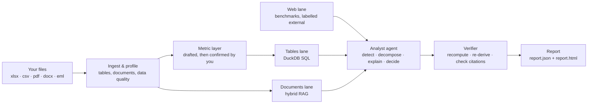

# agentic-analytics

**Open-source, self-hosted agentic analytics. Any data in, verified decisions out.**

Give it a business's real files: spreadsheets, CSV exports, PDFs, Word documents and emails. It returns a report on what changed, why it changed, where things went wrong, and what to do next. Every number in that report is computed by SQL and recomputed by a verifier. Every claim links to the exact row, cell, page or URL it came from.

> Status: **pre-alpha, in development.** This README describes the target for v0.1. See [docs/ROADMAP.md](docs/ROADMAP.md) for progress.

---

## Why this exists

AI data tools fail in three ways that this project is designed to fix:

1. **Wrong numbers, stated confidently.** The model does arithmetic in its head, or reads a spreadsheet as text. Here, every figure comes from DuckDB SQL, and an independent verifier recomputes every figure before the report ships.
2. **Correct math on the wrong thing.** The model measures a nearby metric, the wrong period, or gross where you meant net. Here, metric definitions are drafted first, you confirm them, and the verifier checks every number against the confirmed definition.
3. **Advice with no basis.** "Consider improving marketing." Here, a recommendation has to cite the findings behind it, give an impact range and a confidence level, and name the metric and date that will prove it right or wrong.

It runs **fully locally, at $0**. Local models run through Ollama and web search through self-hosted SearXNG. There's no telemetry, and your data never leaves your machine.

## How it works

1. **Ingest and profile.** Tables are detected inside messy spreadsheets: merged headers, several tables on one sheet. Documents are parsed into sections. Data-quality problems are reported as findings in their own right.
2. **Metric layer.** The engine drafts definitions: what "revenue" means, the time grain, the currency, any filters. You confirm or edit them. Anything you leave unconfirmed is flagged on every finding that uses it.
3. **Analyze.** A deterministic library of SQL insight templates finds the changes. Decomposition methods (price–volume–mix, rate vs mix, contribution, risk ratio) split each change into its drivers. The model only chooses among these computed facts and explains them.
4. **Explain.** Drivers are matched to events found in your documents and to outside benchmarks from the web. Each "why" is graded as observed, correlated, or supported by evidence.
5. **Decide.** Recommendations are ranked by expected impact, with a range, a confidence level, the evidence behind them, and a check date.
6. **Verify.** Every number is recomputed, the key metrics are re-derived independently, and every citation is checked to support its claim. Anything that fails is dropped or downgraded before the report ships.

An interactive walkthrough lives in [docs/assets/blueprint.html](docs/assets/blueprint.html).

## Use it four ways (target for v0.1)

| Door | Example |
|---|---|
| CLI | `aa analyze ./q2-exports --open` |
| HTTP API | `POST /v1/jobs` with files → `GET /v1/jobs/{id}/report` |
| MCP server | Claude Desktop, Cursor or any agent calls `analyze_files` and gets the typed report back |
| Telegram demo | Send files to a bot and get the summary and HTML report back |

## Stack

TypeScript (Node 22) and Hono, with DuckDB for all SQL and all search (full-text and vector) in one file per analysis. The Vercel AI SDK provides a provider-neutral model layer, with Ollama and OpenAI-compatible free endpoints by default. Hard PDFs and scans can go through an optional Docling container. Embeddings and reranking run locally. Everything is packaged with Docker Compose.

The reasoning behind each choice is in [docs/DECISIONS.md](docs/DECISIONS.md).

## Documentation map

| Doc | What it covers |
|---|---|
| [docs/PRD.md](docs/PRD.md) | Product requirements: problem, users, scope, success metrics |
| [docs/ARCHITECTURE.md](docs/ARCHITECTURE.md) | System design, packages, data flow, diagrams |
| [docs/specs/](docs/specs) | Detailed specs for every subsystem |
| [docs/EVALS.md](docs/EVALS.md) | How quality is measured and what the bar is |
| [docs/ROADMAP.md](docs/ROADMAP.md) | Milestones with acceptance criteria |
| [docs/ENGINEERING.md](docs/ENGINEERING.md) | Local setup, git workflow, CI, testing, releases |
| [docs/DOCS-SITE.md](docs/DOCS-SITE.md) | Plan for the public docs site with visual explainers |
| [AGENTS.md](AGENTS.md) | Rules for AI coding agents working in this repo |

## License

Apache-2.0. Built by [fhsystems](https://fhsystems.dev).
