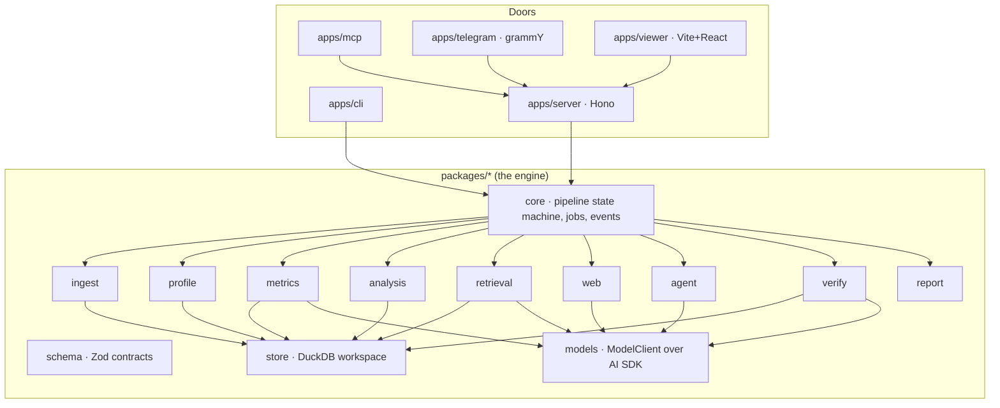
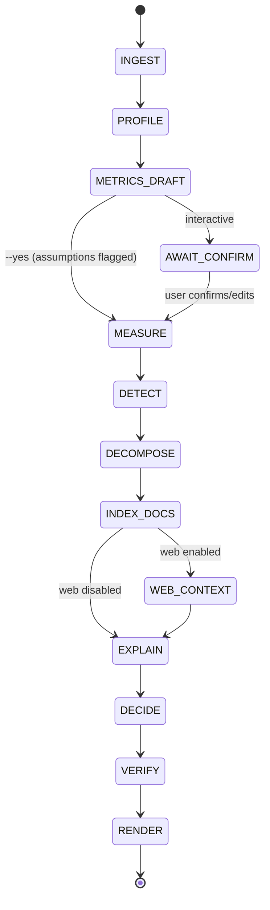

# Architecture

## 1. Shape

The engine is a library first: a set of plain TypeScript packages with typed inputs and outputs and no knowledge of HTTP. Every way of using it is a thin adapter over that library:

- the HTTP API,
- the MCP server,
- the CLI,
- the Telegram bot,
- the viewer.

A future hosted product (NestJS, multi-tenant) imports the same packages.



## 2. Pipeline

A job moves through fixed stages. Each stage reads from and writes to the job's DuckDB workspace, emits progress events, and checkpoints. A crashed job resumes from the last completed stage. The interrupted stage first has its facts deleted (from the fact number it started at) and its own rows reset. Before PROFILE completes there is nothing to keep, so the workspace starts fresh. MEASURE runs the analysis library once (measure, detect and decompose in one deterministic pass). DETECT and DECOMPOSE are the checkpoints that report what it stored.



| Stage | Package | Deterministic? | Model use |
|---|---|---|---|
| INGEST | ingest | yes | none (Docling optional) |
| PROFILE | profile | yes | none |
| METRICS_DRAFT | metrics | proposal by model, validated by code | small model proposes YAML; code validates every column and expression |
| MEASURE | analysis | yes | none |
| DETECT | analysis | yes | none |
| DECOMPOSE | analysis | yes | none |
| INDEX_DOCS | retrieval | yes | embeddings only |
| WEB_CONTEXT | web | retrieval yes, extraction by quarantined model | quarantined extractor |
| EXPLAIN | agent | model reasons over computed facts and extracts | planner model |
| DECIDE | agent | model proposes; impact ranges computed by code | planner model |
| VERIFY | verify | yes, plus entailment checks | small judge model for entailment |
| RENDER | report | yes | none |

The facts-only boundary: after DECOMPOSE, the model only receives a **fact sheet**. That's a structured list of computed facts, each with an ID, a value, a computation record and provenance. Every number the model writes must reference a fact ID. The verifier rejects any number that doesn't.

## 3. Data model inside a job workspace (DuckDB file)

| Table | Contents |
|---|---|
| `files` | id, name, sha256, mime, size, status |
| `sources` | every detected table or document section, with provenance (file, sheet, A1 range, page, char span); `meta` holds email headers |
| `t_<id>` | one physical table per detected source table, with normalized columns plus `_row` (original row number) |
| `profile_columns`, `profile_tables` | profiling results |
| `quality_issues` | data-quality findings with provenance |
| `entities`, `entity_links` | matched entities across files |
| `metric_defs` | confirmed or assumed metric definitions (YAML, compiled SQL and its params, status) |
| `facts` | every computed number: id, value, unit, sql, params, input row refs, definition id |
| `insights` | detected changes and anomalies (templates output), referencing facts |
| `decompositions` | driver breakdowns, referencing facts |
| `chunks` | document chunks: exact source text, source span, heading path, contextual prefix, `embedding FLOAT[]` (dimension follows the model) |
| `fts_main_chunks` | DuckDB FTS (BM25) index over chunk prefix and text |
| `retrieval_meta` | the embedder, dimension and stemmer that built the chunk index |
| `extracts` | quarantined-extractor outputs (structured, typed), with source refs |
| `web_results` | URL, title, fetched_at, extract refs. Always `external = true`. Each fetched page is also a `sources` row (`kind = 'web'`, id `W…`) holding its readable text and URL/title/fetch time in `meta`. |
| `claims` | every sentence-level claim in the draft report, with fact and citation refs |
| `verification` | per-claim and per-number verification results |
| `events` | progress log |
| `job_stages` | pipeline checkpoints: status per stage, where its facts start, its small JSON output |
| `job_meta` | the job's id and options (inputs are copied to `<job folder>/input/`) |

## 4. Packages

| Package | Responsibility | Spec |
|---|---|---|
| `schema` | Zod schemas: report v1, metric YAML, config, events; JSON Schema export | specs/report-schema.md |
| `store` | Open, create and close job workspaces; migrations; typed query helpers | ARCHITECTURE §3 |
| `core` | Pipeline state machine, job runner (in-process queue), checkpoints, event bus, structured logging | ARCHITECTURE §2 |
| `ingest` | Type sniffing, SheetJS grid read, table-region detection, CSV, DOCX, PDF, EML, Docling client | specs/ingestion-and-profiling.md |
| `profile` | Profiling, normalization, entity matching, quality findings | specs/ingestion-and-profiling.md |
| `metrics` | Draft, validate and compile metric definitions | specs/metric-layer.md |
| `analysis` | Measure, insight templates, decomposition, baselines, Simpson guard, impact-range math | specs/analysis-library.md |
| `retrieval` | Chunking, embeddings, FTS, vector search, RRF fusion, rerank, citation spans | specs/retrieval.md |
| `web` | Search providers (SearXNG first), fetch, readable-text extraction, query sanitizer | specs/security.md |
| `models` | `ModelClient` over the AI SDK; providers `ollama` and `openai-compatible`; `FakeModel` for tests; model profiles | specs/models.md |
| `agent` | Fact-sheet builder, quarantined extractor, planner, explain, decide, tools | specs/agent-and-verifier.md |
| `verify` | All verification passes and the failure policy | specs/agent-and-verifier.md §7 |
| `report` | report.json assembly and React SSR to self-contained HTML | specs/report-schema.md |

Apps: `server` (Hono), `cli` (citty), `mcp` (MCP SDK, stdio + streamable HTTP), `telegram` (grammY), `viewer` (Vite + React), `docs` (Astro Starlight).

## 5. Repo layout

```
agentic-analytics/
├── AGENTS.md  CLAUDE.md  README.md  LICENSE  .env.example
├── package.json (workspaces)  bun.lock  turbo.json  biome.json  tsconfig.base.json
├── apps/
│   ├── server/   cli/   mcp/   telegram/   viewer/   docs/
├── packages/
│   ├── schema/  store/  core/  ingest/  profile/  metrics/
│   ├── analysis/  retrieval/  web/  models/  agent/  verify/  report/
├── evals/
│   ├── datasets/        # synthetic businesses + answer keys (YAML)
│   ├── generator/       # dataset generator with planted insights/distractors
│   ├── injection/       # prompt-injection fixtures
│   └── runner/          # scoring + results tables
├── fixtures/            # nasty real-world-style files for parser tests
├── examples/            # demo data used in README/docs/GIF
├── docker/              # Dockerfiles
├── docker-compose.yml   # engine, searxng (profile: web), docling (profile: docling), ollama (profile: ollama)
└── docs/                # this planning set + assets
```

## 6. Deployment

- **`docker compose up`** starts the engine on port 8080. Compose profiles add the optional services:
  - `--profile web` adds SearXNG;
  - `--profile docling` adds docling-serve;
  - `--profile ollama` adds Ollama (users with Ollama installed natively skip this).
- **Volumes:** `./data/jobs/<jobId>/` holds the uploads, `workspace.duckdb`, `report.json` and `report.html`.
- **Single process.** The job runner is in-process with a concurrency limit (default 1 on CPU-only hosts). The later SaaS swaps in BullMQ behind the same `JobQueue` interface.

## 7. Extension points

- **`ModelProvider`:** add providers (Anthropic and OpenAI later) without touching the engine.
- **`SearchProvider`:** add Brave or Tavily.
- **`Parser`:** add file types.
- **`InsightTemplate` and `Decomposer`:** add analysis methods. Each needs tests and a docs page.
- **`Renderer`:** add output formats (PDF via Playwright later).
