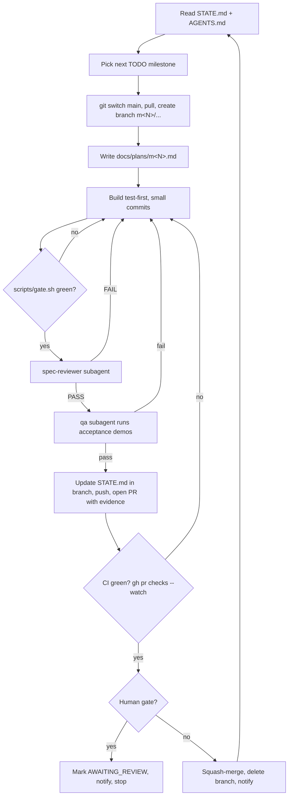

# Autopilot: the build loop that runs without you in the middle

You start it once. It works through the roadmap milestone by milestone: plan, build, test, review, push, open the PR, wait for CI, merge, update the ledger, then move on to the next milestone. It only stops for a human gate or a real blocker, and it messages you on Telegram when it does.

## 1. Pieces

| Piece | File | Job |
|---|---|---|
| Ledger (memory between sessions) | `docs/progress/STATE.md` | Status of every milestone, PR links, blockers, decisions agents made |
| Rules | `AGENTS.md` | What agents must and must not do |
| Cycle command | `.claude/commands/milestone.md` → `/milestone N` | One full milestone cycle |
| Loop command | `.claude/commands/autopilot.md` → `/autopilot` | Picks the next milestone from STATE.md and runs the cycle |
| Status command | `.claude/commands/status.md` → `/status` | Short report from STATE.md, open PRs and CI |
| Reviewer | `.claude/agents/spec-reviewer.md` | Independent review of the diff against specs, acceptance criteria and AGENTS rules; returns PASS/FAIL |
| QA | `.claude/agents/qa.md` | Runs every acceptance demo from a clean state and captures the output |
| Quality gate | `scripts/gate.sh` | lint + typecheck + tests + schema drift + smoke evals + build |
| Hooks | `.claude/settings.json` | Auto-format after edits; blocks the agent from finishing while the gate fails |
| Outer loop | `scripts/autopilot.sh` | Runs `/autopilot` headless with a fresh context per milestone, until done or a gate is hit |
| Notifications | `scripts/notify.sh` | Optional free Telegram message on every merge, gate and blocker |

## 2. The cycle (one milestone)



Limits that keep it honest:

- **Fix loops are capped.** The reviewer gets 3 FAIL rounds and CI gets 3 failure rounds. After that, the milestone is marked `BLOCKED` with the reason, a notification goes out, and the loop stops.
- **Fresh context per milestone.** The outer script restarts Claude for each milestone, so long runs don't degrade.
- **Nothing reaches `main` except through a PR** that passed every gate.
- **Token budget (AGENTS.md §9, from 2026-10-22).** The reviewer and QA steps (G, H) run only for engine, numeric or security changes (QA on Sonnet, the spec-reviewer on Opus); docs, site, test-only and eval-tooling PRs go from the gate straight to the PR and CI. One PR at a time and one background agent, with no exceptions since 2026-10-31 (AGENTS.md §9, the v0.1 finish plan: builders and QA on Sonnet, the main session and the security/engine spec-reviewer on Opus, no agent kept only to wait on CI, the main session reviews and merges, a final v0.1 review before the tag); a PR merges as soon as it is ready; no real-model runs outside the nightly.

## 3. Human gates (the only planned stops)

| Milestone | Why you look |
|---|---|
| M1 | `notify`: merges and continues; you review the report look when convenient |
| M11 | `notify`: merges and continues; the default model is chosen once real-model results exist |
| M12 | `yes`: **stops**. Making the repo public and launching is your call. |

Since 2026-10-21 the maintainer's standing instruction (STATE.md, top) makes every later gate `notify`: the loop doesn't stop for milestones. It still skips, and notes under Blockers, anything that needs an explicit yes: a v* tag or release, public announcements, repo settings or visibility, money or private credentials.

Blockers don't stop the loop. Missing models, services or keys become DEFERRED checks, unclear specs become recorded decisions, and unmet criteria become known gaps. The loop only hard-stops when it truly can't proceed: no GitHub auth, an uninstallable free dependency, or something that needs money.

To pass a gate:

1. Review the PR on GitHub.
2. Merge it yourself, or tell Claude "approved, merge M1".
3. Set the milestone to `DONE` in STATE.md, or let Claude do it.
4. Restart `scripts/autopilot.sh`.

Gates can be edited in STATE.md.

## 4. One-time setup (on your laptop)

```bash
# tools
node -v                  # 22+
bun --version            # 1.4+, package manager (curl -fsSL https://bun.sh/install | bash)
gh auth login            # GitHub CLI, logged in as gfirik (needed for repo create, PRs, merges)
# no Ollama needed: tests use FakeModel and embeddings run in-process

# optional: Telegram notifications (free)
#   1) Talk to @BotFather, create a bot, copy the token
#   2) Send your bot any message, then open https://api.telegram.org/bot<TOKEN>/getUpdates to read your chat id
#   3) Add to ~/.bashrc (NOT to the repo):
export AA_TG_TOKEN="<token>"
export AA_TG_CHAT="<chat id>"
```

## 5. Start it

**Option A: fully autonomous** (recommended once M0 is merged):

```bash
cd ~/startups/agentic-analytics
bash scripts/autopilot.sh
```

**Option B: interactive, inside Claude Code:**

```
/autopilot        # runs milestones until a gate or blocker
/milestone 3      # runs one specific milestone
/status           # where are we?
```

The first run handles M0, including `git init`, creating the private GitHub repo and the first PR. Run it interactively so you can watch the setup once.

## 6. Cost

- **Claude Code** runs on your Claude plan, so long autonomous runs use your plan's limits. If a run hits a limit, `scripts/autopilot.sh` waits 30 minutes and retries.
- **Everything else is $0:**
  - GitHub private repo;
  - GitHub Actions free minutes (2,000 a month on a private repo; CI never calls models);
  - Ollama;
  - free model endpoints, only for evals;
  - Telegram.

## 7. Safety rails

- **Allow-list.** `.claude/settings.json` allows only what the loop needs: bun, bunx, node, git, gh, docker compose, ollama, and read-only file tools.
- **Hard denies:**
  - pushing to `main` directly;
  - force-pushing;
  - `rm -rf` outside the repo;
  - reading `.env` files;
  - `curl` or `wget` to arbitrary URLs.
- **No auto-merge at human gates.**
- **Every merge** has a gate-green, reviewer-PASS, QA and CI trail in the PR.
- **To stop it at any time:** press Ctrl+C in the terminal, or set any milestone to `BLOCKED` in STATE.md.
