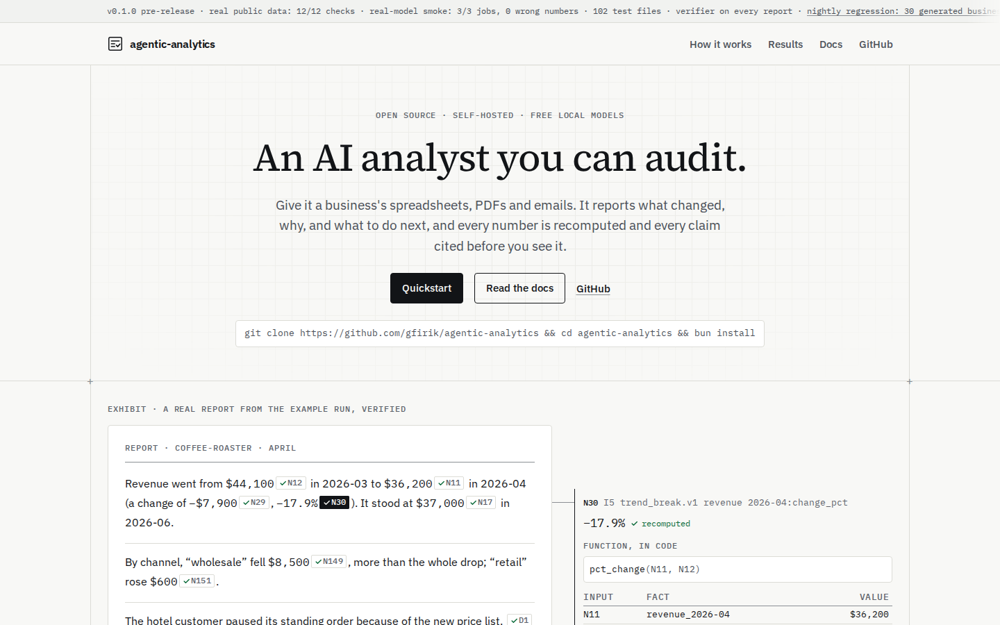
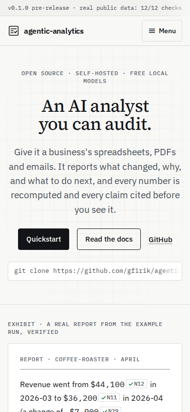
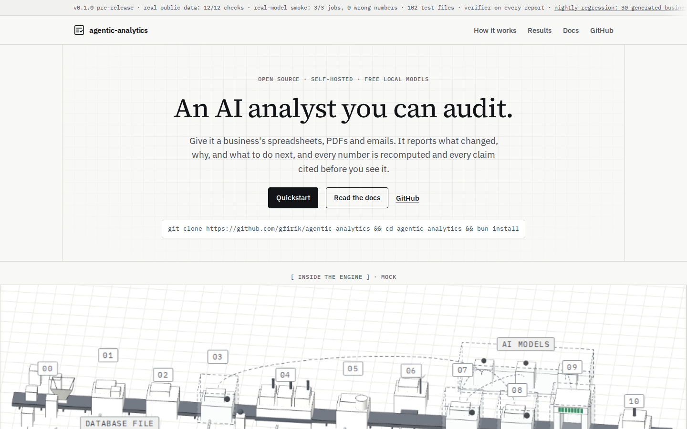
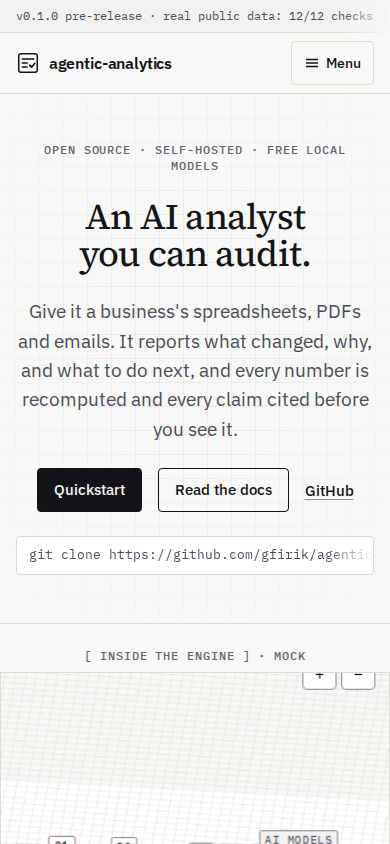
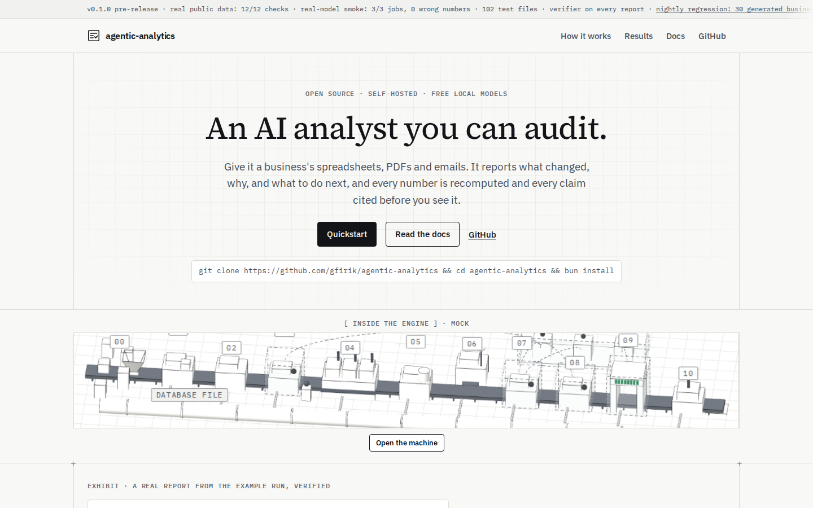
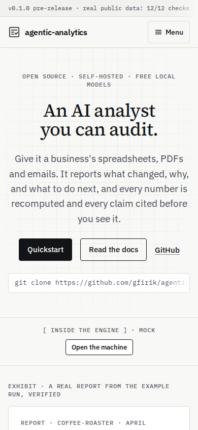

# Plan: the 3D engine machine on the landing page (for review)

**Status:** plan only, for the maintainer's review (requested 2026-10-21, after M14a). Nothing is built until it's approved.

**Source:** the approved prototype `~/startups/aa-design/engine-machine.html`. It is a design reference, not code to paste. It shows the pipeline as a factory line in an axonometric 3D view:
- eleven numbered stations on a conveyor;
- the DuckDB workspace in front, and the model room "behind glass" for the steps that call a model;
- a spec sheet for the selected station;
- three guided modes: "Take the tour", "Follow −17.9%" and "Run the line".

It loads three.js r128 and OrbitControls from two CDNs and its fonts from Google Fonts. The site version may do neither.

## 1. Where it goes

The maintainer's wish: in or right under the hero, above the exhibit. DESIGN.md §5 also says the exhibit's top must be visible above the fold at 1440×900. The two pull against each other, so three placements were mocked on the current build. Each mock drops the prototype's own render into the page with no styling work; a mock shows position and size, not finish.

| Option | Where | Exhibit top at 1440×900 | At 390×844 | Keeps the fold rule |
|---|---|---|---|---|
| Before (today) | none | 548 px | 623 px | yes |
| **A** | full machine (520 px) between the hero and the exhibit | 1141 px | 1116 px | **no**: the exhibit leaves the first screen at both sizes |
| **B** | full machine right under the exhibit, before §1 | 548 px | 623 px | yes, but it's no longer "in the hero" |
| **C (recommended)** | a short static strip of the machine (170 px) under the hero, with an **Open the machine** button that expands it in place to the full interactive view (520 px at 1440, 420 at 390); on phones only the label and button show | 820 px | 717 px | yes |

**Recommendation: C.** It puts the machine where the maintainer wants it, keeps the exhibit (DESIGN.md §11's "strongest thing on the site") on the first screen, and only costs bytes and motion when a reader asks for it. Opening it moves the exhibit down. That is the reader's choice, and it happens below the fold of their attention, so it isn't a layout shift in the CLS sense: CLS ignores shifts within 500 ms of an input.

Screenshots (`docs/plans/site-3d/`, taken from a local build of main with the mock injected, reduced motion on):

| | 1440 × 900 | 390 × 844 |
|---|---|---|
| Before |  |  |
| A |  |  |
| C |  |  |

B leaves the first screen as it is; `site-3d/B-1440-top.png` and `site-3d/B-390-top.png` show it below the exhibit. The open state is shot in the build PR (§4).

## 2. How it fits DESIGN.md (what changes there)

The design system currently rules this out in three places (§1, §2.6 and §9) and limits motion in two (§2.5 and §7), so the build PR amends DESIGN.md in the same PR:

| DESIGN.md today | The amendment |
|---|---|
| §1: not "an AI startup page (no gradients, glow, blobs, **3D**, robots or brains)"; §2.6 and §9: "No gradients, glow, blobs, **3D** …" | One exception: the engine machine, an axonometric line drawing of the real pipeline. It uses hairline edges and two surface tones from the tokens, through unlit materials (`MeshBasicMaterial`, so no light-dependent shading). It has no shadows and no glow. 3D as decoration stays banned. |
| §2.5: the exhibit's replay is the only motion that starts by itself; §7: the landing's motion is the replay, the walkthrough, the pipeline stages after Play and 150ms transitions, "No other motion" | §2.5 is kept: the machine never moves by itself. §7 gains one entry: the machine moves only on the reader's input (drag, the view buttons, and the tour, trace and "Run the line" when pressed), and under reduced motion every guided mode jumps to its end state. |
| §5, the landing sections | The hero gets a fourth part: the machine strip under the install line (option C). |
| §6, the components | A new entry, `EngineMachine.astro`: the strip, the open state, the labels, the sheet, the fallback and the loading rules below. |
| §10, the checklist | A line: the machine's labels and sheet are HTML. |

The rest of the design system holds as it is:
- **Light only:** a one-theme scene. Its clear colour, edges and surfaces come from the CSS tokens, read at runtime with `getComputedStyle`, so nothing is typed twice.
- **Colour:** green only on verified things. In the prototype that's the check marks in "Follow −17.9%" and the verifier station's gate.
- **Labels are HTML,** never canvas text: station tags, the legend, the sheet, the toolbar. They are positioned over the canvas from projected coordinates, using DESIGN.md type tokens (`--aa-text-label` and up) and focusable buttons with `aria-pressed`. The canvas is `role="img"`, its label points to the station list, and every station is in a plain HTML list that works without the canvas.
- **Every number is real:**
  - the stations, their names and order come from the same data as §1's pipeline stages (`docs/assets/readme/pipeline.json` and the stage list), not from a second hand-written list;
  - "Follow −17.9%" follows the run's own headline fact (N30) through its real inputs.
  
  `landing-exhibit.test.ts` gets a check that the machine's figures match the run.
- **Fonts:** the self-hosted ones; no Google Fonts.

## 3. Loading, fallback and performance

- **three.js self-hosted** as a pinned npm dependency of `apps/docs` (`three@0.186.1`, the current release; a DECISIONS.md entry, since AGENTS.md §3 lists the stack). It is imported as ES modules from `three` and `three/examples/jsm/controls/OrbitControls.js`, so the bundler tree-shakes it. No third-party requests, so `site-browser`'s same-origin check stays green.
- **Bundle cost, measured** (esbuild, minified, the 24 classes the prototype uses plus OrbitControls):

  | | minified | gzip |
  |---|---|---|
  | three, tree-shaken to what the machine uses | 570 KB | **142 KB** |
  | all of three, for comparison | — | 189 KB |
  | the machine's own code (the prototype's script, as a guide) | 49 KB | ~17 KB |
  
  The total is about **160 KB gzip**, in one lazy chunk. Tree-shaking saves less than hoped, because `WebGLRenderer` pulls in most of three.
- **When it loads.** Option C puts the strip on the first screen at both sizes (the exhibit's top is at 820 and 717), so "when it scrolls into view" would mean "on every page load". A prefetch on view would therefore fetch about 160 KB, and parse it (`modulepreload` compiles too), on every visit, including Lighthouse's mobile run. The plan differs from the literal ask on purpose:
  - nothing loads with the page;
  - the chunk is fetched on the first hover, focus or pointerdown on **Open the machine** (intent), with `fetchpriority="low"`, and run on the click. On phones, which have no hover, it is fetched on the tap itself;
  - Lighthouse's mobile run, which neither hovers nor taps, loads none of it. The browser test asserts that no machine chunk is requested before interaction.

  The literal option (load and show the still machine when it scrolls into view) is offered in §5. It would cost the 160 KB on every first screen under option C.
- **Static fallback image:** the strip (at 1440 and other wide screens) and the closed state are a real image of the machine (AVIF/WebP plus PNG, about 30 KB, with explicit `width`/`height`). It is rendered at build time from the same scene by the docs `assets` script, like `og.png`, and covered by `site-assets.test.ts`'s input hash. The fallback is the whole experience for:
  - **no JS:** the image plus the station list as HTML. On phones, where option C shows only the label and the button, the button is a link to the station list (a `
`), so no-JS and weak-device phones get the list and the image inside it;
  - **`prefers-reduced-motion`:** the machine still opens, but every guided mode jumps to its end state and the camera doesn't animate;
  - **weak devices:** no WebGL, `navigator.hardwareConcurrency ≤ 2`, `deviceMemory ≤ 2` or Save-Data. The button then opens the station list and the sheet over the static image, without loading three.
- **No layout shift:** the strip's box is fixed by the image's dimensions. Opening reserves its height (aspect-ratio) before the canvas mounts.
- **Budgets (acceptance for the build PR):**
  - Lighthouse ≥ 95 on `/` (mobile);
  - axe clean;
  - no horizontal scroll at 360 px;
  - CLS 0 on load;
  - one browser test that opens the machine, tabs through the stations and checks there are no off-origin requests.

## 4. The build PR (after approval)

One PR, on its own branch from main:
1. DESIGN.md amendments (§2) and a DECISIONS.md entry for `three`.
2. `EngineMachine.astro` and its client module, ported from the prototype:
   - the scene, controls, tour, trace and "Run the line";
   - tokens instead of hex;
   - HTML labels;
   - data from the run.
3. The build-time fallback render, plus tests: site assets, landing data, and a browser test (open, keyboard, no third-party requests, reduced motion, 360 px).
4. Screenshots at 1440 and 390 (closed and open), a Lighthouse run on `/`, then the reviewer and QA as usual, and a Telegram after merge.

**Risks in the port** (the prototype is three r128; the site would pin 0.186):
- **Colour management** has been on by default since r152, with sRGB output. Token colours read through `getComputedStyle` must be set as sRGB (`Color.setStyle` with `ColorManagement` handled), or every surface renders shifted from the page's own tokens. A browser test samples a canvas pixel against `--aa-surface`.
- **OrbitControls** moves from `examples/js` (a global) to the `jsm` module, and its API changed slightly (for example `listenToKeyEvents`). The keyboard handling is rewritten against it.
- **Renamed or removed APIs** between r128 and 0.186 (geometry and material options, `outputEncoding` → `outputColorSpace`) are found by typechecking the port, not by eye.

The two-agent and heavy-job rules apply. The site stays frozen apart from this change.

## 5. Decisions for the maintainer

1. **Placement:** C (recommended), A (your first wish, which breaks the fold rule), or B.
2. **The DESIGN.md exception** for one 3D explainer, as worded in §2.
3. **Loading:** about 160 KB gzip, fetched on intent (hover, focus or tap on Open; recommended), or literally when the section scrolls into view (on every first screen under C), or only on the click.
4. **The spec sheet:**
   - the full sheet from the prototype (calls, tables, SQL, model pill);
   - or a shorter sheet that links into Learn's stage pages, which already explain each stage. That keeps one source per stage.
   
   Recommended: the shorter sheet.
