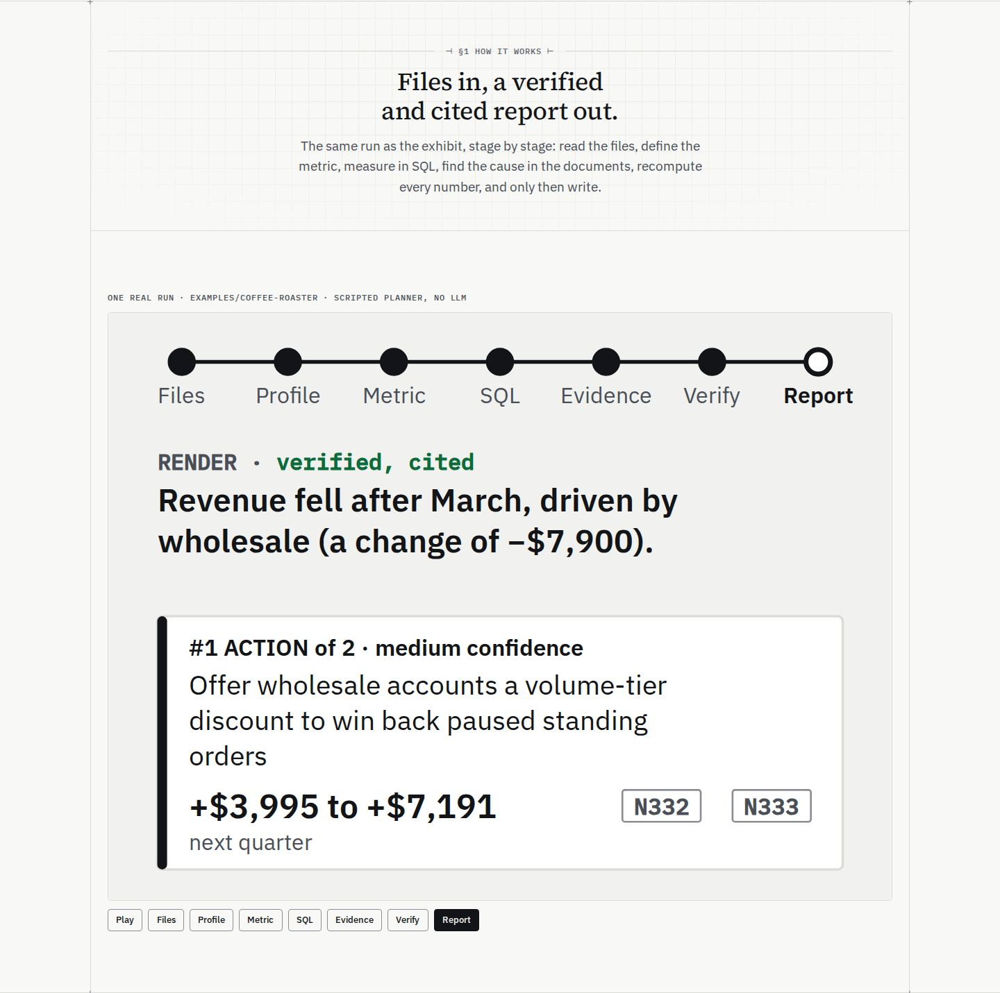
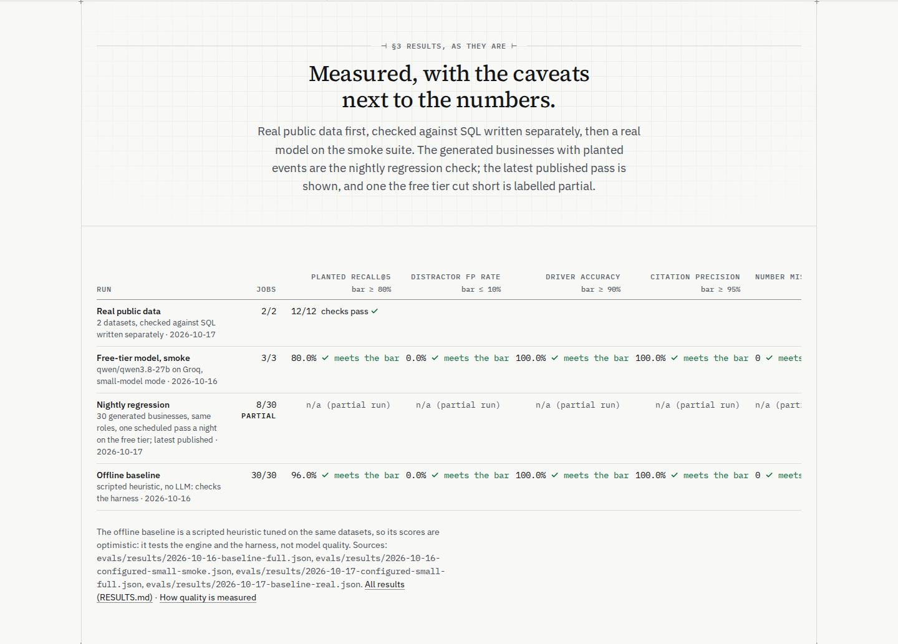
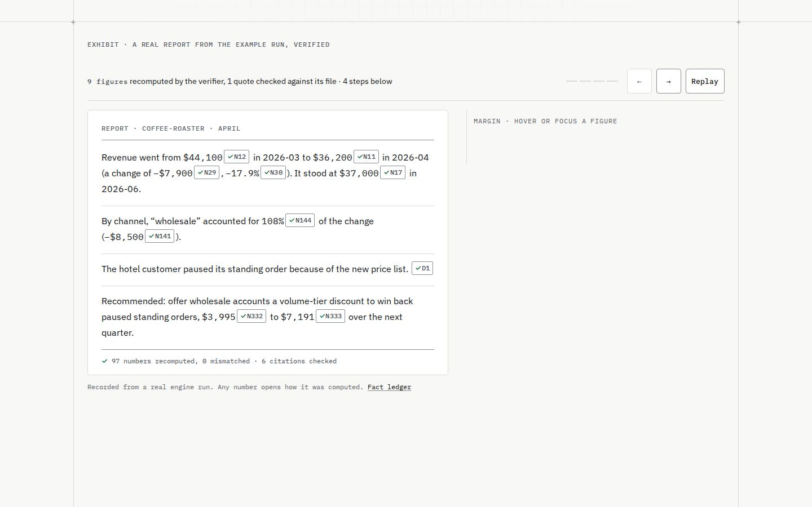
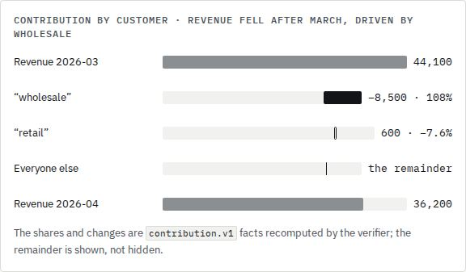
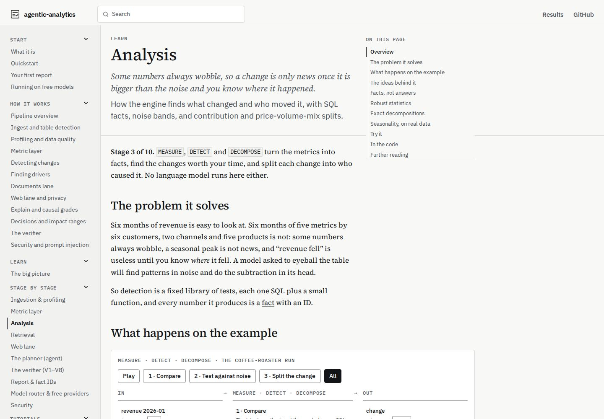
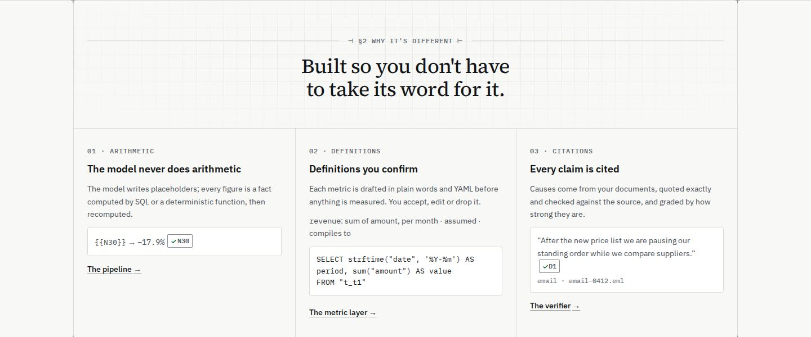

# Site v3: plan

Plan for the design pass in `docs/design/site-v3.md` (the brief, committed alongside this plan; folded into `apps/docs/DESIGN.md` §11 and deleted by PR 5). Nothing in the site changes in this PR. After review, the work lands as five PRs in the brief's order of work (§2). The last of them folds the brief into `apps/docs/DESIGN.md` and deletes it.

**The maintainer's decisions (2026-10-20)** are folded into the sections below and recorded in §4. In short:
- One code size, 0.8125rem.
- The note-size floor applies to reading text only; mono uppercase labels and chips keep `--aa-text-label`.
- The walkthrough drops scroll-pinning at every size and is timed everywhere.
- Pipeline Play stops at Report.
- No bullet mark.
- Finding 9 moves to the analyst-grade plan (#35) as an engine task.
- The docs h1 stays at 2.5rem, and the size rule is amended to allow it.

"Before" screenshots of every section of `/`, `/learn/` and `/learn/stages/analysis/` at 1440×900 and 390×844 are in [`site-v3/before/`](site-v3/before/) (index in §5). They were built from main at `cde4011` and served locally. The scratch capture script is not committed.

## 1. Rules for every PR

These come from the maintainer's instructions. Each PR's description lists how it meets each one.

- **Tokens:** only DESIGN.md tokens. A new token is added to `tokens.css` and DESIGN.md in the same PR.
- **Type scale:**
  - Nothing renders larger than `--aa-text-h2` (2.25rem, 1.75 under 640px) except the hero statement and a page's own h1.
  - No reading text inside a figure is smaller than `--aa-text-note` (0.8125rem). Mono uppercase labels and fact chips are not reading text; they keep `--aa-text-label` (0.75rem), and nothing goes below that.
  - A figure is any diagram, island, ledger or framed panel, with everything inside its frame:
    - the exhibit and its notes;
    - the pipeline;
    - the results table;
    - the §2 examples;
    - StageFlow;
    - the waterfall;
    - CitationDemo, VerifierDiff, RagStepper, FactLedger, LearnMap and Transcript.
  - Code is one size everywhere: `--aa-text-code`, 0.8125rem.
- **Motion:** none beyond DESIGN.md §7, as amended in that PR (see decision D3).
- **DESIGN.md** is updated in the same PR.
- **Screenshots:** before/after at 1440 and 390 in the PR description.
- **Quality bars:**
  - Lighthouse ≥ 95 on `/` and `/learn/`;
  - axe clean;
  - no horizontal scroll at 360px, except inside `.aa-ledger-wrap`.
- **Process:**
  - the heavy-job lock (`scripts/heavy.sh`) and at most two background agents;
  - the spec-reviewer and QA verdicts posted on the PR;
  - squash-merge on green;
  - Telegram after each merge;
  - check `gh run list --branch main` after each merge.

## 2. The PRs, in order

| # | PR (branch) | Findings | Main files |
|---|---|---|---|
| 1 | `m13l/pipeline-native` | 1, 10, the "pipeline" motion line, and the amended size rules in DESIGN.md | new `PipelineStages.astro`, index.astro §1, 3 MDX pages, DESIGN §2/§4/§5/§6/§7 |
| 2 | `m13l/results-transpose` | 2 | index.astro §3, `apps/docs/scripts/generate.ts` (evals.json) |
| 3 | `m13l/walkthrough-timed` | 3, 4, plus extra findings A and B | Exhibit.astro, ExhibitNote.astro, components.css (`.aa-chip`) |
| 4 | `m13l/heads-and-code` | 5, 6, 7 | index.astro, site.css, tokens.css, StatusStrip.astro, astro.config.mjs |
| 5 | `m13l/learn-visuals` | 8, 11, 12, 13 (10 is closed by PR 1); the brief folded into DESIGN.md and deleted | Decomposition.tsx, StageFlow.tsx, learn.css, islands.css, starlight.css, index.astro §2 |

Finding 9 is no longer part of site v3. It is an engine task in the analyst-grade plan (#35).

## 3. Findings: change, files, DESIGN.md edits, risks

### Finding 1 (critical): the pipeline scene is the README GIF, upscaled. PR 1.

The scene's text renders at about 32–48px at 1440, and its headline at about 56px. At 390 it is about 10–14px, so a second, ruled-list version sits under it (`landing-03-how-390.jpg`). The same island is on `/learn/` (`learn-fig-pipeline-*.jpg`), `start/what-it-is` and `how-it-works/pipeline`.

**Change.** Replace the island with a native component, `components/site/PipelineStages.astro`, rendered on the server with a small inline script, like the exhibit (no React, so less JS on `/learn/`):

- **The stage rail:** seven mono uppercase labels at `--aa-text-label` on a 1px `rule` line, with an ink progress segment up to the current stage. Each label is a button (`aria-pressed`), so the separate row of stage buttons goes away and the Play baseline problem (finding 10) disappears with it.
- **One ledger-style panel per stage**, at body and note sizes, on `raised` with a hairline. Every panel holds real run data from `docs/assets/readme/pipeline.json`:

  | Stage | Panel |
  |---|---|
  | Files | a ruled table: name, kind, what was found (tables or sections) |
  | Profile | tables, document sections and data-quality issues, with the issues named |
  | Metric | the definition (label = formula, per grain, status) and its compiled SQL, two lines |
  | SQL | from → to, the change and the driver, as figures with `.aa-chip`s |
  | Evidence | the quote with its source chip and file |
  | Verify | V1–V8 as a ruled table: check, name, count, a pass mark (`.aa-check`) |
  | Report | the action with its impact range and horizon |

- **Layout:**
  - All panels are server-rendered in one grid cell (the exhibit's grid-stack trick), so stepping never moves the page.
  - Panel content is chosen so the shortest (Files) is not a near-empty block; the cell's height is the tallest panel's.
- **Play** steps through the stages, about 2.5s each (about 17.5s in all), while the component is on screen, and stops at Report; it doesn't loop (D3). While playing, the button reads Pause and names its next action, as in the exhibit (no `aria-pressed`). Pressing a stage stops playback on that stage. Changing stage crossfades the panel content only, in 150ms, with no moving packets. Reduced motion swaps the panels instantly.
- **Without JS, under reduced motion, and under 40rem:** the same panels stacked as a ruled list with stage labels. That replaces `.aa-pipe-steps`, the second version.
- **The README GIF** keeps `pipeline-scene.ts` and its renderer (`scripts/readme-assets`). The site no longer imports the scene, and `Pipeline.tsx` is deleted.

**Files:**
- **New:** `apps/docs/src/components/site/PipelineStages.astro`.
- **Using it:**
  - `src/pages/index.astro` (§1);
  - `src/content/docs/learn/index.mdx`;
  - `start/what-it-is.mdx`;
  - `how-it-works/pipeline.mdx`. Its paragraph about "animated … packets" is reworded.
- **Deleted:** `src/components/Pipeline.tsx` and the `.aa-pipe*` rules in `islands.css`.
- **Full-width selector:** the rule that makes the pipeline span the margin column (in `starlight.css`) targets the new class.
- **Tests:**
  - `scripts/site/browser/site.spec.ts`: "the pipeline scene is still until Play is pressed" becomes "still until Play; Play steps to Report and stops; a stage button selects its panel; the page doesn't move".
  - A unit test that every panel figure is a fact in pipeline.json.
- **The README's generated text, if any,** is left alone.

**DESIGN.md:**
- **§5 landing order item 2:** "the pipeline stages: a stage rail and one ledger panel per stage".
- **§6 Diagrams:** the scene paragraph becomes "the pipeline scene is README-only".
- **§6:** a new "Pipeline stages" component entry.
- **§7:** Play and the 150ms panel crossfade.
- **§4 and §2: the amended size rules** (§1 of this plan): nothing larger than h2 except the hero and a page's own h1; the note-size floor applies to reading text in figures; labels and chips keep `--aa-text-label`.
- **§2 principle 5 and the §7 "Landing" bullet** are reworded: the exhibit's replay and walkthrough are the only motion that starts by itself; the pipeline moves only after the reader presses Play.

**Risks:**
- **Panel heights.** The grid stack makes the cell as tall as the Verify table (8 rows). The Files panel sits in that height with a ruled table and a hairline-terminated space, not an empty box. If it still reads as empty in the after-screenshots, the fallback is a two-column panel layout at ≥ 1100px for the short stages.
- **Lighthouse on `/learn/`.** Removing a React island should help. The inline script must stay small.
- **The pipeline-data drift test** must keep pointing at the same JSON (unchanged).

### Finding 2 (critical): the results table scrolls sideways at 1920. PR 2.

At 1440 it is cut off at "NUMBER MIS…". "✓ meets the bar" is repeated in every cell, and "n/a (partial run)" five times.

**Change.** Transpose the table:

- **Rows** are the five metrics. Each row label states the bar once ("Planted recall@5 · bar ≥ 80%").
- **Columns** are the four runs: Real public data, Smoke, Nightly regression and Offline baseline. Each head has the run name, model or note, date and jobs (`3/3`).
- **Cells** hold the figure, plus `.aa-check` with its "meets the bar" in screen-reader text only, or a struck "below bar" in ink.
- **Spanning cells:**
  - the partial nightly run gets one cell spanning all metric rows: "partial: 8/30 jobs, metrics not computed";
  - Real public data gets one spanning cell: "12/12 checks against SQL written separately; not scored on these metrics".
  - The counts in these cells (8/30, 12/12) are read from evals.json fields (`completed`/`datasets`, the real checks), never typed; the quoted text is the wording around them.
- **Sources** go into a `
` ("Sources: 4 result files") under the table, with the RESULTS.md and "How quality is measured" links kept visible.
- It fits 1180px with no scroll. At 390 it stays one table inside `.aa-ledger-wrap` (the allowed exception), with the metric column sticky.

The optional bullet mark per cell is left out (D4).

**Files:**
- `src/pages/index.astro` (§3 markup and styles);
- `apps/docs/scripts/generate.ts`/`apps/docs/scripts/landing-data.ts`, only if the per-run head needs fields evals.json lacks;
- `site.spec.ts`: a new test that the results table fits 1440 with no inner scroll, the partial run has one spanning cell, and every figure equals evals.json;
- `scripts/test/evals-table.test.ts`, if it covers the site rows.

The README table (`statusBlock()`, `## Results`) stays as it is.

**DESIGN.md:** §5 item 4 describes the transposed table, and §6 "Ruled table" gets the spanning-cell and sticky-first-column rules.

**Risks:**
- **Rowspan and screen readers.** Use `<th scope="row">` for the metrics and `headers`/`scope` so axe and screen readers read each cell's run and metric.
- **Spanning cell height.** The partial run's spanning cell must not look like a failure. It is ink text and is not struck.

### Finding 3 (moderate): the walkthrough track is long and empty. PR 3.

**Measured:**
- At 1440×900 the sticky section is 2,824px for four steps (the brief measured 3,172px at 1000px tall).
- While pinned, there are about 200px of empty space under the panel.
- The "EXHIBIT ·" label scrolls away.
- At step 0 the margin is an empty box with "MARGIN · HOVER OR FOCUS A FIGURE".

**Extra findings from the screenshots (same PR):**
- **A. Mobile notes stretch.** In the stacked notes cell, a shorter note's rows spread out to the tallest note's height (`landing-02-exhibit-step1-notes-390.jpg`).
- **B. Mobile step 0.** At step 0 the notes cell is a 543px empty block under the figure (`landing-02-exhibit-notes-390.jpg`).

**Change (D2, maintainer's decision): one behaviour everywhere, the timed walkthrough. No scroll-pinning at any size.**
- **Removed:**
  - the sticky section;
  - the `.aa-walk-track`;
  - the scroll mode and its `(min-width: 68.75rem) and (min-height: 44rem)` query;
  - the scroll-to-step code for prev, next and Replay.

  The exhibit section is as tall as its content.
- **Timing:**
  - The verification replay runs when the exhibit comes into view.
  - The steps then advance every 4.5s while the exhibit is in view, and pause when it leaves.
  - Pause/Play names its next action. Prev and next use `aria-disabled` at the ends. Replay restarts from the verification.
  - Hover or focus inside the exhibit holds the timer, and stepping by hand pauses it (as the small-screen mode does today, WCAG 2.2.2).
  - At the last step it stops, and Play restarts from step 1.
- **The step bar** sits in the exhibit's head, under the exhibit label, so the label stays with it. It isn't sticky on wide screens, where the figure and its note are on screen together. Under 900px, where the notes are below the figure, it stays sticky at the top of the exhibit while the exhibit is on screen. That is a control bar, not a scroll-linked track; dropping it is one CSS rule if you want no sticky at all.
- **Step 1's note open by default.** Before and during the verification, the margin shows step 1's note rather than the empty hint. The hint is removed. Step 0's caption still says what the verifier did.
- **Notes size to their own content.**
  - The grid-stack (every note in one cell) goes, which fixes A.
  - So the page doesn't move as the steps change, the notes area gets a `min-height` equal to its tallest note. It is measured once, after the fonts load and before the walkthrough starts, while the exhibit is still below the fold or the notes are beside it.
  - Short notes sit at the top of that space, with no stretched rows.
- **Small screens (under 900px): SQL behind "Show SQL".**
  - In each note, the SQL block is a `
` ("Show SQL", closed by default, which works without JS).
  - The tallest collapsed note is the cited-rows table plus the head, about 300px at 390 instead of 543px, so the reserved space stays short. That fixes B.
  - Opening it is the reader's own input, so the movement it causes is expected.
  - From 900px, beside the exhibit, the SQL shows open as now.
- **Reduced motion or no JS:** the static ruled list under the exhibit, unchanged.

**Files:**
- `apps/docs/src/components/site/Exhibit.astro`: script, markup and styles;
- `ExhibitNote.astro`: the SQL `
` under 900px;
- `scripts/site/browser/site.spec.ts`:
  - the desktop scroll test is replaced by "the walkthrough advances on a timer at 1440 too";
  - the timed-mode test now runs at 1440 and 390;
  - the 1100×704 note-fit test is replaced by "the notes area never changes height while stepping (1440, 390)";
  - the reduced-motion and no-JS list tests are kept;
- `apps/docs/scripts/site-screenshots.ts`: the step shots and `--record` drive the timer, not scrolling.

**DESIGN.md:**
- §6 "The guided walkthrough": timed everywhere, the step bar, step 1's note by default, notes sized to content with a reserved height, "Show SQL" under 900px.
- §6 "Margin notes": no hint.
- §7: the landing walkthrough is timed, not scroll-linked.

**Risks:**
- **A reader who scrolls past.** The timer pauses when the exhibit leaves the view, and resumes when it comes back.
- **The reserved height on desktop.** The tallest note (SQL plus cited rows) can be taller than the exhibit page. Then the row grows once, at measurement, below the fold or before the walkthrough starts, and never while stepping. CLS stays 0, and Lighthouse checks it.

### Finding 4 (moderate): the chips make the exhibit prose choppy. PR 3.

**Change.** `.aa-chip` becomes lighter:
- `ink-3` text;
- a `rule` box instead of `rule-strong`;
- a tighter visual box (padding 0 4px) that does not raise the line height, while the hit area stays at least 24×24px (DESIGN.md §8) through a transparent `::after` hit box instead of `min-height: 1.5rem`. The chip gets `position: relative`; at 12px the content box is about 16px, so the hit box uses `inset: -5px 0` (about 26px), and a browser test measures it at ≥ 24px;
- the check appears only once verified, as now in the exhibit;
- hover, focus and open states unchanged.

The size stays `--aa-text-label` (D1): the chip is lighter by colour and box, not by size.

**Files:** `src/styles/components.css` (`.aa-chip`), and the `Exhibit.astro` scoped chip rules.

**DESIGN.md:** §6 "Fact-ID chip" (colour, box, size) and §8 (the chips reach 24×24 through a hit box, not padding).

**Risks:**
- **Contrast.** `ink-3` on `raised` is above 4.5:1 (5.6:1 on page), so fine.
- **Other pages.** Docs sidenotes and Learn use the same chip, so the after-screenshots must include `/learn/stages/analysis/`.

### Finding 5 (moderate): section heads aren't one pattern. PR 4.

**Change.** Every landing section head is the label, then the h2, then a one-sentence lead (≤ about 90 characters), with the same spacing tokens: `space-4` from label to h2, `space-3` from h2 to lead, and `space-8` cell padding.

- **h2 measure:** widened from `24ch` (with `text-wrap: balance`) to 30ch, so each h2 is one line at ≥ 1100px.
- **New copy** (proposed; numbers stay out of it):

  | Section | Lead |
  |---|---|
  | §1 | "One real run, stage by stage, from files to a verified report." |
  | §2 | "Three rules the engine can't break." |
  | §3 | "Real public data first; partial runs labelled partial." |
  | §4 | "Install, pick a free model, analyze the example." |

**Files:** `src/pages/index.astro` (heads), `src/styles/site.css` (`.aa-h2` measure, `.aa-cell-head` spacing) and `SectionLabel.astro` (spacing only).

**DESIGN.md:** §5 gets a "Section heads" rule (label → h2 → one-sentence lead, the spacing tokens, the h2 measure).

**Risks:**
- **h2 at 390.** At 1.75rem it still wraps, which is fine.
- **§3's caveat.** The lead's caveat text moves under the table, so the partial-run explanation isn't lost.

### Finding 6 (moderate): code sizes are inconsistent. PR 4.

Code currently renders at:

| Where | Size |
|---|---|
| Hero install line | 0.8125rem (`index.astro:468`; the brief's 16px is out of date) |
| §2 code | 0.8125rem |
| Quickstart | 0.75rem |
| Exhibit notes | 0.6875rem |
| Docs (Expressive Code) | 0.875rem |

**Change.** One code size (D1, maintainer's decision): a new token, `--aa-text-code: 0.8125rem / 1.55`, used everywhere. That covers the hero, §2, Quickstart, the exhibit notes, StageFlow, FactLedger SQL and params, Transcript and Expressive Code (`--ec-codeFontSize`, 0.875 → 0.8125rem).

- **Step 3's command** breaks at a logical point (`AA_DEMO_MODEL=scripted \` / `bun run aa analyze examples/coffee-roaster \` / `--yes --embedder hash`), so "--embedder hash" never splits. There is no copy button: it would add JS and a second state for a no-JS page.
- **The hero install line** is already at 0.8125rem and stays one line inside its scroll box (the CLS fix from #34). It only moves onto the token.

**Files:**
- `tokens.css` and `site.css`;
- `index.astro` (`.aa-hero-cmd`, `.aa-proof-code`, `.aa-code`);
- `ExhibitNote.astro` (0.6875 → the token; the mono labels inside notes stay `--aa-text-label`);
- `learn.css` and `islands.css`;
- `astro.config.mjs` (Expressive Code `styleOverrides`).

**DESIGN.md:** §4 scale gets `--aa-text-code`, and §6 "Code" changes to 0.8125rem.

**Risks:**
- **Docs code shrinks.** Docs code drops from 0.875 to 0.8125rem, as decided: denser, but the same everywhere.
- **Bigger note code makes the notes taller.** PR 3's reserved height and the "Show SQL" toggle absorb it, and PR 4 re-checks the notes-height test.

### Finding 7 (moderate): native scrollbars on mobile. PR 4.

**Change.** The status strip and the install line hide the scrollbar visually:
- `scrollbar-width: none` and `::-webkit-scrollbar { display: none }`;
- a fade at the overflowing edge, using `mask-image` (transparency, like the graph-paper fade, not a coloured gradient), shown only while there is more to scroll. A `data-overflow` attribute is set by a tiny script on scroll and resize; without JS the edge always fades when the content is wider.

Keyboard focus, the focus ring and scrolling are unchanged (`role="region"`, `tabindex="0"`).

**Files:** `StatusStrip.astro`, `index.astro` (`.aa-hero-cmd`) and a shared `.aa-scroll-x` utility in `components.css`.

**DESIGN.md:** §5 "Status strip" and a §6 "Horizontal scroll boxes" rule.

**Risks:**
- **Discoverability.** Hiding the scrollbar hides the affordance; the fade carries it.
- **Layout shift.** The mask must not change the layout. The CLS test from #34 (box heights while fonts arrive late) still covers both.

### Finding 8 (moderate): the "waterfall" isn't a waterfall. PR 5.

**Change.** `Decomposition.tsx` becomes a true bridge:
- **Bars:** start total → each driver's delta → end total, with 1px `rule-strong` connectors from each bar's end to the next one's start.
- **Scale:** deltas on a readable scale through an axis break. The two total bars are drawn broken (a ≈ mark on a white gap near their base), with no numeric tick: the break mark shows the axis is truncated, and the only numbers are the two totals and the deltas, each with its fact chip. Bar geometry is layout only, never shown as a number.
- **Title:** from the decomposition's dimension ("Contribution by channel"), not the hard-coded "by customer".
- **"Everyone else":** the island computes it today (`after − before − known`), which is arithmetic in the UI. The row is dropped when the decomposition lists a driver for every member (the decomposition's member count equals the driver count, read from the report, with no subtraction: the driver count against the length of the `delta:total` fact's `computation.inputs`, e.g. N143 = `sum(N142, N141)`, two inputs for two drivers); here that is wholesale and retail. When a remainder exists, it is shown only from the engine's own remainder fact, if `contribution.v1` emits one; if not, the plan for that is a follow-up, not a UI subtraction.
- **Readability:** text sizes in the figure are ≥ 0.8125rem, and negative deltas are solid ink, positive outlined (DESIGN §3).

**Files:** `src/components/Decomposition.tsx` and `islands.css`, also used on `start/first-report` and `how-it-works/drivers`.

**DESIGN.md:** §6 gets a "Contribution bridge" component entry.

**Risks:**
- **Truncated axes can mislead.** The break mark and the labelled axis start are required, and the figures sit beside the bars.
- **Not computing in the UI.** Removing the island's subtraction means checking that `contribution.v1` covers all members (a unit test on coffee.json).

### Finding 9 (moderate): "wholesale accounted for 108% of the change". Moved out of site v3.

By the maintainer's decision (D5), this is an engine task in the analyst-grade plan (#35): an absolute-value fact, plus a comparison the verifier can check, for shares over 100%. What the site v3 review found about it still holds:
- **"Fell {{N}}" with a negative N** is dropped by V4 (`packages/verify/src/verify.ts:234`, report-schema §5a).
- **"More than the whole drop"** is a numeric comparison, so it needs a check the verifier can recompute.

The site keeps the engine's current wording until that lands. The exhibit regenerates from the run, so it picks the new wording up when the run data is regenerated.

### Finding 10 (minor): Learn's Play button sits off the baseline. PR 1.

This is closed by the rebuild: the stage labels are the buttons and Play sits in the same rail row. PR 5 re-checks it in the Learn screenshots.

### Finding 11 (minor): the Learn TOC clips with an inner scrollbar. PR 5.

**Change.** The margin TOC's cap goes from `min(20rem, 40vh)` to `calc(100vh - var(--sl-nav-height) - var(--aa-space-8))`. The TOC shows h2s only on Learn pages (the analysis page lists 12 entries today, h3s included, and clips after "Further reading"; with h2s only it has 8), so it fits without an inner scrollbar at 1000px tall. The step-aside behaviour is unchanged.

**Files:** `src/styles/starlight.css` (`.aa-margin-toc-inner`), and the Starlight `tableOfContents` levels for Learn.

**DESIGN.md:** §5 "The on-page TOC" (height cap, h2 only on Learn).

**Risks:** A taller TOC overlaps more sidenotes. The step-aside JS already handles that; the screenshots must check it.

### Finding 12 (minor): StageFlow step descriptions are at label size. PR 5.

**Change.** Descriptions (`learn.css:80`, `.aa-flow-note`) go from 0.75rem to `--aa-text-note`. The same rule (reading text in figures ≥ note size, labels and chips at `--aa-text-label`, code at `--aa-text-code`) also covers, in this PR:
- **Reading text raised to `--aa-text-note`:**
  - CitationDemo's evidence table (`islands.css:72`, `.aa-ev table`);
  - VerifierDiff's reasons (`islands.css:164`, `.aa-diff .reason`, which keeps mono);
  - RagStepper and Transcript text wherever it sits under 0.8125rem.
- **Code moved onto `--aa-text-code`:** FactLedger SQL and params (`learn.css:159`, `:164`).
- **A label raised to `--aa-text-label`:** CitationDemo's grade (`islands.css:57`, `.aa-grade`, 0.6875rem). Nothing goes below the label size.
- **Unchanged, because they are labels:**
  - StageFlow column heads and the arrow (`learn.css:25`, `:32`);
  - LearnMap lane heads, steps and in/out marks (`:179`, `:224`, `:239`);
  - the island labels (`islands.css:15`);
  - figcaptions (`:201`);
  - the Transcript caption (`learn.css:104`).

A browser test reads the computed sizes inside every figure. Reading text must be ≥ 0.8125rem, and labels and chips ≥ 0.75rem.

**Files:** `learn.css`, `islands.css` and `StageFlow.tsx`, if a class changes.

**DESIGN.md:** §6 "Stage diagram" sizes.

**Risks:** Columns get taller. Under 50rem they stack already.

### Finding 13 (minor): §2's examples have uneven heights, and cell 1's is thin. PR 5.

**Change:**
- Cell 1 shows a report sentence before and after rendering. That is the stored claim text with its placeholders (`… a change of {{N29}}, {{N30}}`) and the rendered sentence with figures and chips, both from `exhibit.json` (`landing-data.ts` adds the claim's raw text).
- The three examples sit in a fixed-height example band at the bottom of each cell (grid rows: label / h3 / sentence / example / link), so the cells line up.

**Files:** `index.astro` (§2), `apps/docs/scripts/landing-data.ts`, and `landing-exhibit.test.ts` (the raw text equals the report's claim).

**DESIGN.md:** §5 item 3 (the arithmetic cell's example).

**Risks:** The report must keep the placeholder text. If `report.json` stores only rendered text, the generator reads it from the run's claims checkpoint instead.

### Extra finding C: the docs h1 is larger than h2. Resolved by amending the rule.

The docs h1 stays at 2.5rem (maintainer's decision). PR 1 amends the rule to "nothing larger than h2 except the hero and a page's own h1".

## 4. Decisions (made by the maintainer, 2026-10-20)

- **D1/D6, size rules:**
  - One code size, 0.8125rem, docs included.
  - The note-size floor applies to reading text in figures only. Mono uppercase labels and chips keep `--aa-text-label` (0.75rem).
  - The rule's wording in DESIGN.md is updated (PR 1).
  - A figure keeps the broad definition: any diagram, island, ledger or framed panel.
- **D2, walkthrough:**
  - No scroll-pinning at any size. One behaviour everywhere: the timed walkthrough. It starts when the exhibit is in view, has Pause, prev and next, and pauses on hover and focus.
  - Step 1's note is open by default.
  - Notes size to their own content.
  - On small screens the SQL sits behind "Show SQL".
  - This replaces the 543px empty block and the stretched notes (PR 3).
- **D3:** agreed. Play steps through once and stops at Report, with a 150ms crossfade and no loop.
- **D4:** agreed. No bullet mark in the results table.
- **D5:** finding 9 is removed from site v3 and added to the analyst-grade plan (#35) as an engine task.
- **Docs h1:** stays at 2.5rem. The rule reads "nothing larger than h2 except the hero and a page's own h1".

## 5. Before screenshots

All are in [`site-v3/before/`](site-v3/before/): JPEG. Viewport and section shots are 1440 or 390 wide (1440×900 or 390×844 viewports; a tall section is taller). The figure shots are cropped to the figure element, so they are narrower. The landing and its walkthrough were captured with motion allowed.

- **Landing (`/`):**
  - top (strip, header, hero): `landing-01-top-{1440,390}`;
  - exhibit, arriving: `landing-02-exhibit-arrive-{1440,390}`;
  - exhibit, pinned at 1440: `landing-02-exhibit-step{0,2,4}-1440`;
  - exhibit at 390: `landing-02-exhibit-figure-390`, `-notes-390` (step 0), `-step1-notes-390`;
  - §1: `landing-03-how-{1440,390}`;
  - §2: `landing-04-why-{1440,390}`;
  - §3: `landing-05-results-{1440,390}`;
  - §4: `landing-06-quickstart-{1440,390}`;
  - footer: `landing-07-footer-{1440,390}`.
- **`/learn/`:**
  - top: `learn-00-top-{1440,390}`;
  - each h2 section in full, from its h2 to the next (a full-page clip): `learn-01…05-*-{1440,390}`;
  - the pipeline figure: `learn-fig-pipeline-{1440,390}`.
- **`/learn/stages/analysis/`:**
  - top: `analysis-00-top-{1440,390}`;
  - each h2 section in full, from its h2 to the next (a full-page clip): `analysis-01…07-*-{1440,390}`;
  - StageFlow: `analysis-fig-stageflow-{1440,390}`;
  - the waterfall: `analysis-fig-waterfall-{1440,390}`;
  - the TOC at 1440×1000: `analysis-toc-1440x1000`.

The after-screenshots for each PR use the same names under `docs/plans/site-v3/after/<pr>/`. `scripts/site-screenshots.ts` gains a `--sections` mode in PR 1, so the capture is reproducible from the repo, not a scratch script.
